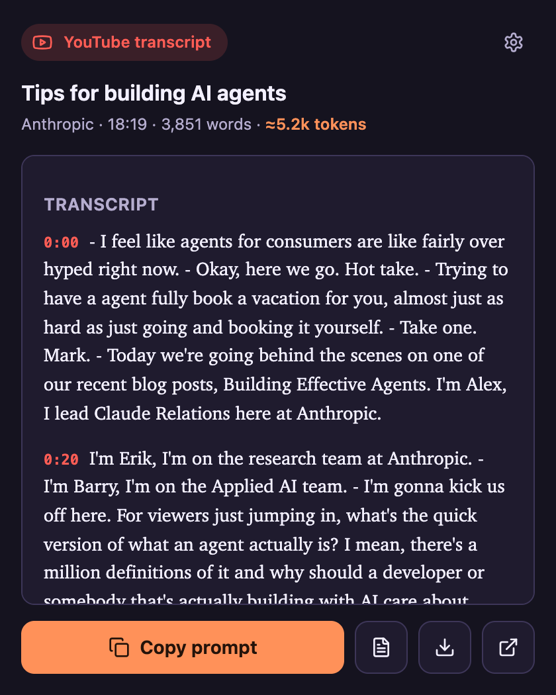
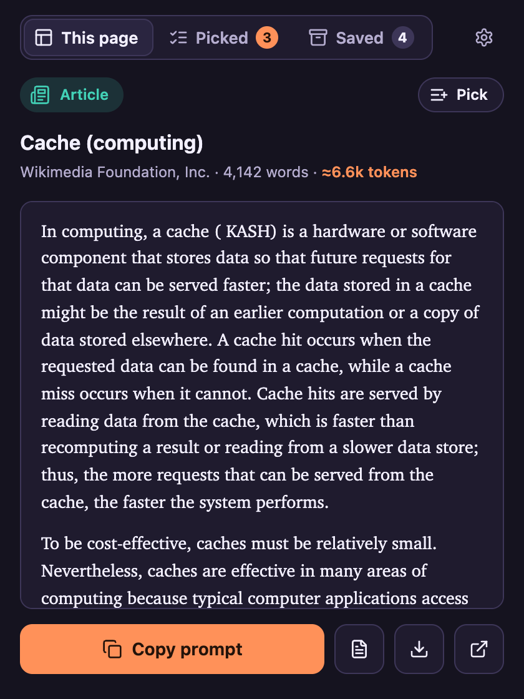
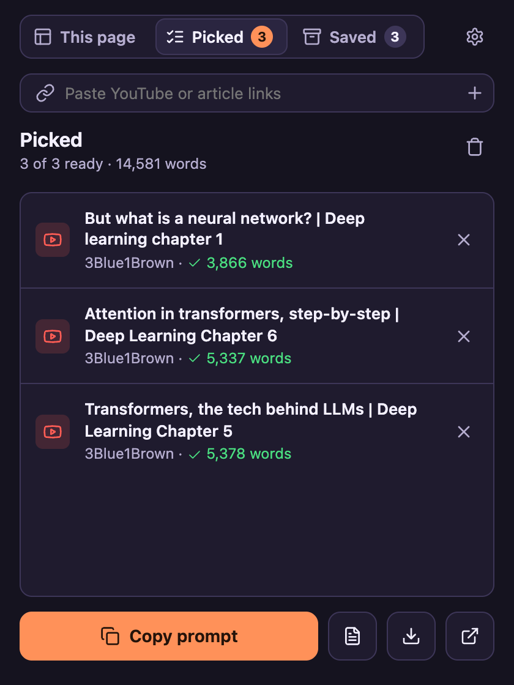
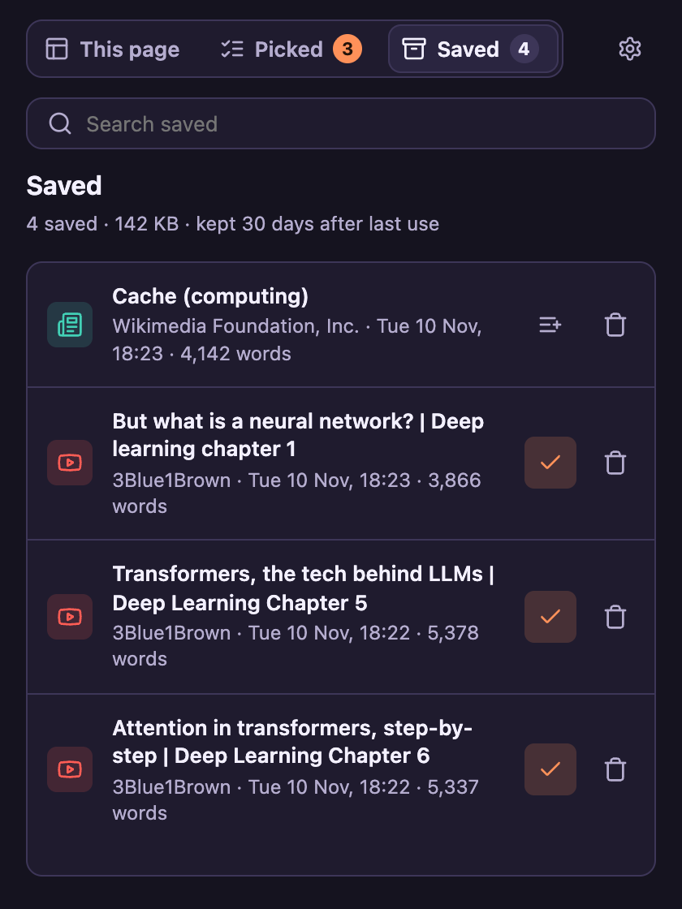
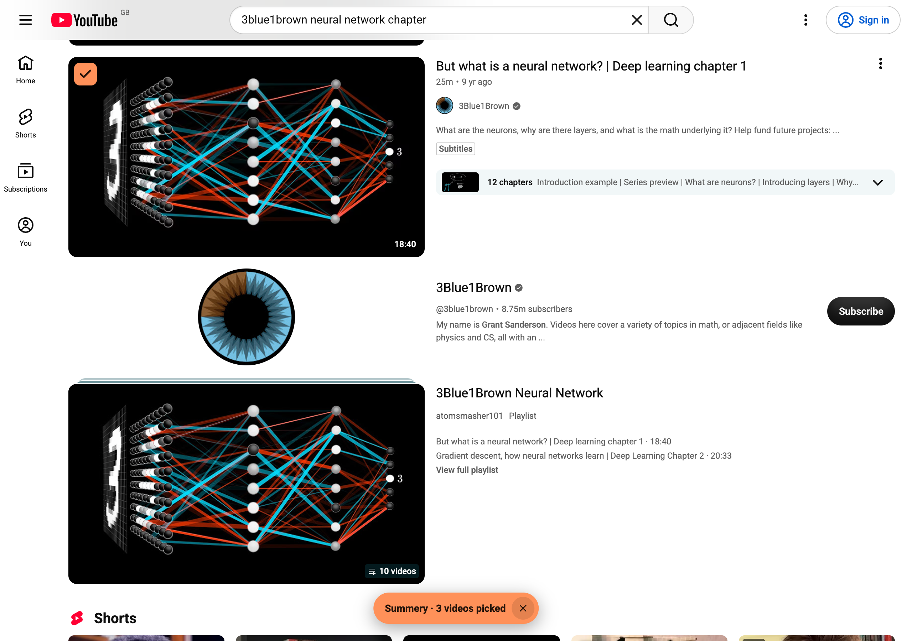
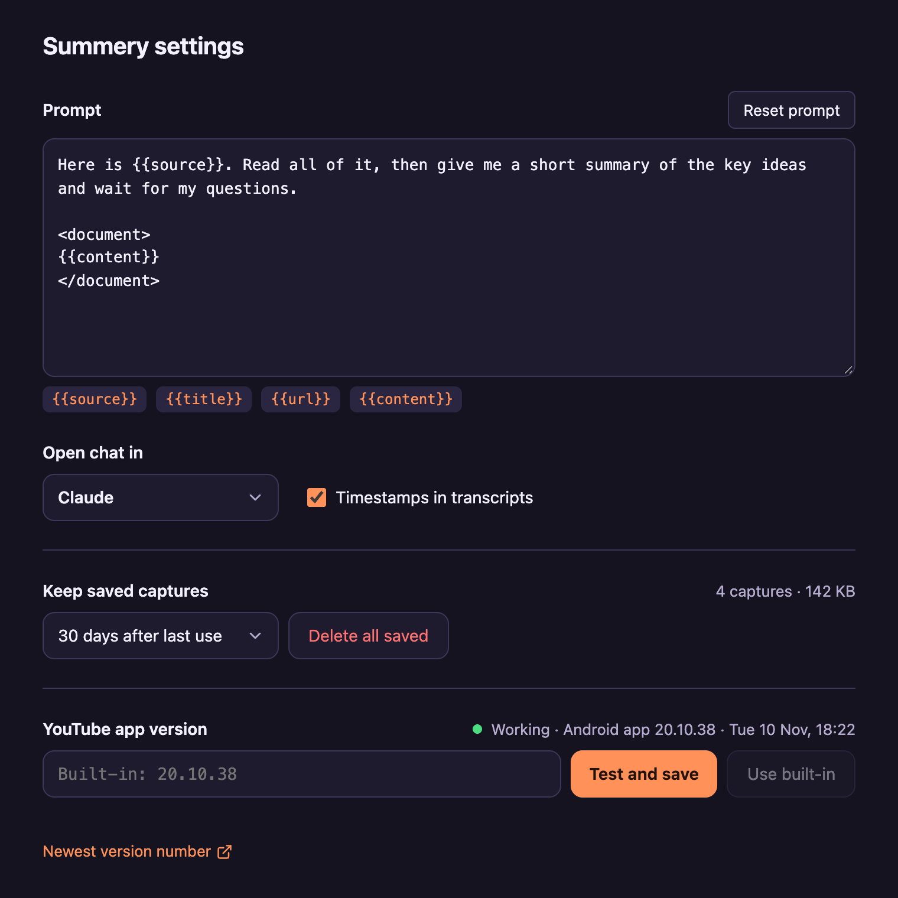

# Summery

*Summaries, with a summery disposition.*

<a href="LICENSE"></a>
<a href="https://buymeacoffee.com/willlacf"></a>

Chrome extension that turns a YouTube video or any web page into a ready-to-paste chat prompt.

- **YouTube**: full transcript with timestamps, channel, length and description.
- **Any page**: the main article text as Markdown, without menus, ads, images or link clutter.
- **Selection**: select a passage first to copy only that.
- **Several at once**: pick videos and articles, then copy them as one prompt.
- **Saved**: everything you capture is kept on this computer, so you can come back to it.

| YouTube talk | Web article |
| --- | --- |
|  |  |

| Picked | Saved |
| --- | --- |
|  |  |





## Install

```sh
npm install
npm run build
```

1. Open `chrome://extensions` and turn on **Developer mode**.
2. **Load unpacked** and pick the `dist` folder.
3. Pin Summery to the toolbar.

After a code change, run `npm run build` and press reload on the extension card.

## Use

- Click the icon: preview, then **Copy prompt**, copy text only, download `.md`, or copy and open Claude.
- Right-click a page, a selection, or any YouTube video link: **Copy … as prompt**.

### Pick several

- On a YouTube search, channel or home page, the popup lists the videos: tick the ones you want.
- Turn on **Boxes on thumbnails** to tick videos right on YouTube as you browse.
- On a news front page, the popup lists the stories instead of copying the front page.
- Paste links into **Picked**: tracking like `si=`, `utm_` and `fbclid` is stripped first.
- Right-click any link: **Add link to Summery picks**.
- Picks are fetched in the background. **Picked** copies them as one prompt.
- Reading articles from another site asks for permission to that site once.

### Saved

- Every capture is kept on this computer in the extension's own storage, never uploaded.
- Opening a saved video again uses the copy instead of asking YouTube; **Fetch again** refreshes it.
- **Saved** lists them with search. Settings decide how long they stay: until Chrome closes, 7, 30 or 90 days after last use, or until you delete them.
- Change the prompt, chat site and timestamps in the settings (gear icon).
- Want a hotkey? Set one at `chrome://extensions/shortcuts`.

## Where the data comes from

- Transcripts come straight from youtube.com: the captions YouTube itself serves (its own speech-to-text for auto-generated ones). No third-party service.
- The extension asks YouTube's player API as the Android app does, then downloads the caption track.
- If that fails while you're on the video, it reads YouTube's own "Show transcript" panel instead.
- Pages are read locally with Mozilla's Readability. Picked articles are downloaded from their site and read the same way.
- Nothing leaves your browser except the requests to YouTube and to the sites you pick.

## Develop

```sh
npm test
npm run typecheck
npm run watch
```

## If transcripts stop working

YouTube has probably retired the app version Summery pretends to be. The popup then shows **Update app version**:

1. Open **Newest version number** and copy the latest YouTube version (for example `20.45.36`).
2. Paste it and press **Test and save**. It's only saved if a real test transcript comes back.

A bad saved version can't break anything: Summery falls back to the built-in Android version, then the iPhone app. **Use built-in** undoes your change.

## Support

Issues and PRs welcome. If Summery is useful to you, you can [buy me a coffee](https://buymeacoffee.com/willlacf). ☕

## License

[MIT](LICENSE)
